# 🚀 Awesome-Graphql-Clients

  

  
  
  
  
  

---

## 🌟 Top GraphQL Clients Ecosystem & Developer Directory

**A comprehensive, SEO-optimized curated list of top GraphQL client libraries, SaaS platforms, and developer tooling for React, Vue, Svelte, iOS, Android, Python, Rust, and Node.js.**

*Focused on Normalized Caching, Compiler-Driven Optimization, Type-Safe Queries, Subscriptions, and Self-Hosted Client Tooling.*

📅 **Last updated: October 2026**

---

### 📖 Overview & Architecture Patterns

This repository tracks notable **SaaS platforms** and **open-source client libraries** across the modern GraphQL data-fetching landscape. GraphQL clients eliminate frontend data-plumbing complexity—handling network requests, document vs. normalized caching, optimistic UI updates, reactive query refetching, stream/defer directives, and real-time WebSocket subscriptions.

#### 🎯 Key Architectural Archetypes
- **Normalized Cache Clients** (*Apollo Client, Relay, urql + Graphcache*): Deconstruct query responses into discrete entities by `__typename` and `id`/`keyFields`, enabling automatic synchronization of shared records across disjoint views and components without manual cache invalidation.
- **Asynchronous Key-Value & Stale-While-Revalidate Wrappers** (*TanStack Query, SWR, RTK Query*): Treat GraphQL queries as asynchronous key-value promises. Excellent for incremental REST-to-GraphQL transitions, zero-runtime overhead, and lightweight footprints.
- **Compiler-Driven & Zero-Runtime Clients** (*Relay, Houdini*): Shift query validation, artifact generation, and fragment colocation to compile-time steps, minimizing bundle overhead while guaranteeing strict type safety.
- **Minimal Typed Request Drivers** (*Graffle, GQL*): Lightweight HTTP drivers tailored for Edge runtimes, Server Components (RSC), Node.js scripts, and CLI utilities where client-side memory caching is unnecessary.

---

## 📑 Table of Contents

- [📊 Sector Overview & Market Dynamics](#-sector-overview--market-dynamics)
- [☁️ SaaS/Hosted Platforms](#️-saashosted-platforms)
- [🐙 Open-Source GitHub Projects](#-open-source-github-projects)
  - [Top Client Libraries (Ranked by GitHub Stars)](#top-client-libraries-ranked-by-github-stars)
  - [Architectural Decision Matrix](#architectural-decision-matrix)
- [🤝 How to Contribute](#-how-to-contribute)
- [💖 Support & Sponsor](#-support--sponsor)
- [📈 Star History](#-star-history)
- [⚖️ Disclaimer](#️-disclaimer)

---

## 📊 Sector Overview & Market Dynamics

The global GraphQL platform and developer tooling sector is valued at approximately **$1.27 billion**, operating within the broader **$16+ billion API Management and Data Integration market**.

The market exhibits **moderate fragmentation with strong enterprise concentration at the gateway/federation layer**: while Apollo GraphQL functions as an anchor category leader capturing substantial commercial enterprise mindshare, the client runtime space remains actively pluralistic. Developer preferences remain divided between full-featured normalized cache engines (Apollo, Relay), compiler-driven modern frameworks (Houdini), and agnostic async fetching primitives (TanStack Query, SWR).

---

## ☁️ SaaS/Hosted Platforms

Commercial platforms and hosted cloud backends providing schema governance, federation routers, and API observability for GraphQL clients:

| Platform | Company Valuation / Revenue | Starting Pricing | Free Tier / Trial Limits | Description |
| :--- | :--- | :--- | :--- | :--- |
| **[Apollo Studio (GraphOS)](https://studio.apollographql.com/)** | $1.5 Billion valuation ($170M+ funding) | $5 / million requests (Developer plan) | Forever-free tier capped at 60 requests/minute (RPM) per router, 1-day metrics retention, up to 3 developers | Apollo's commercial supergraph platform for schema registry, usage reporting, and federation management. Integrates with Apollo Client. Enterprise plans available for schema governance. |
| **[GraphQL Editor (Cloud)](https://graphqleditor.com/)** | ~$220,000 annual revenue (Bootstrapped) | $69 / month (Essentials plan) | 14-day free trial of paid cloud features; free/open-source tier restricted to public projects (no private workspaces) | Visual schema design and collaboration platform with a free tier. Includes visual node editor, mock backend generation, and team sharing. |

---

## 🐙 Open-Source GitHub Projects

### Top Client Libraries (Ranked by GitHub Stars)

Below are the industry-leading open-source GraphQL clients and data-fetching libraries, ordered in descending order of community adoption and GitHub stars:

1. **[TanStack Query (React Query)](https://github.com/TanStack/query)**   
   The dominant async state-management and data-fetching powerhouse for TS/JS applications (~5M weekly downloads). Primarily designed for REST and generic async promises, it functions seamlessly with GraphQL via lightweight fetchers (e.g., Graffle or standard fetch). **Best for**: Teams migrating from REST or prioritizing simple document/key caching over normalized caching complexity.

2. **[SWR](https://github.com/vercel/swr)**   
   Vercel's lightweight React hooks library for data fetching utilizing the HTTP RFC 5861 stale-while-revalidate cache invalidation strategy. Compact bundle size, automatic revalidation on focus/reconnection, and deep synergy with Next.js applications.

3. **[Apollo Client](https://github.com/apollographql/apollo-client)**   
   The industry benchmark for feature-complete client-side GraphQL (~4M weekly downloads). Features a powerful normalized in-memory cache, React 19/Suspense hooks, `@defer` and `@stream` support, local state policies, DevTools, and WebSocket subscriptions.

4. **[Relay](https://github.com/facebook/relay)**   
   Meta's high-performance, compiler-driven GraphQL client for React. Enforces strict fragment colocation and schema conventions (Node interface, Connection pagination). The Relay Compiler optimizes runtime overhead by preprocessing query graphs ahead of time into minimal JavaScript artifacts.

5. **[RTK Query](https://github.com/reduxjs/redux-toolkit)**   
   Built into Redux Toolkit, RTK Query eliminates boilerplate for data fetching and caching in Redux applications. Supports GraphQL endpoints with tag-based cache invalidation, polling, and prefetching without requiring secondary caching libraries.

6. **[urql](https://github.com/urql-graphql/urql)**   
   A lightweight, modular, exchange-based client (~1M weekly downloads). Features a tiny core bundle (~14KB) with document caching out-of-the-box and opt-in normalized caching via `@urql/exchange-graphcache`. Highly customizable via functional middleware exchanges.

7. **[Graffle](https://github.com/graffle-js/graffle)** (formerly *graphql-request*)   
   A minimal, zero-dependency, type-safe GraphQL client for modern JavaScript and TypeScript environments. Offers zero caching overhead, making it ideal for React Server Components (RSC), Next.js App Router, Cloudflare Workers, and server-side automation scripts.

8. **[Apollo iOS](https://github.com/apollographql/apollo-ios)**   
   A strongly typed, caching GraphQL client for Apple platforms (Swift, iOS, iPadOS, macOS, watchOS). Generates Swift code from schema documents and supports SQLite normalized caching and Combine/async-await pipelines.

9. **[Apollo Kotlin](https://github.com/apollographql/apollo-kotlin)**   
   A multiplatform GraphQL client built for Kotlin, Android, and JVM. Generates idiomatic Kotlin models from GraphQL operations, offering normalized in-memory and SQLDelight caches with first-class Coroutines/Flow integration.

10. **[graphql-hooks](https://github.com/nearform/graphql-hooks)**   
    A first-class minimal React hooks client (~7KB) created by Nearform. Provides clean hooks (`useQuery`, `useMutation`), server-side rendering (SSR) caching support, and extensible plugin architecture without bundle bloat.

11. **[GQL (Python)](https://github.com/graphql-python/gql)**   
    The premier GraphQL client for Python with support for synchronous requests, asyncio, WebSockets, Phoenix channels, and file uploads. Built for backend-to-backend communication, ETL pipelines, and automation.

12. **[graphql-client (Rust)](https://github.com/graphql-rust/graphql-client)**   
    A typed GraphQL client for Rust using derive macros (`#[derive(GraphQLQuery)]`). Validates queries against schema definitions at compile-time and generates serde-compatible serialization structs.

13. **[Houdini](https://github.com/HoudiniGraphQL/houdini)**   
    A compiler-first GraphQL client tailored for SvelteKit and Svelte (with React support). Features fragment colocation, automatic type generation, optimistic updates, and a "disappearing" runtime that renders queries with near-zero bundle penalty.

14. **[Villus](https://github.com/logaretm/villus)**   
    A tiny (~3KB), fast, and modular GraphQL client for Vue 3 using the Composition API. Offers built-in cache plugins, batching, deduplication, and file upload capabilities.

---

### 🛠️ Architectural Decision Matrix

| Requirement / Scenario | Recommended Solution | Rationale |
| :--- | :--- | :--- |
| **Complex Entity Graphs with Shared Records** | **Apollo Client** or **urql + Graphcache** | Normalized caching automatically synchronizes records across distinct component queries. |
| **Enterprise Compile-Time Guarantee** | **Relay** | Ahead-of-time compiler validates fragments and enforces zero over-fetching. |
| **Svelte & SvelteKit Native** | **Houdini** | Compiler-driven approach designed for Svelte stores and SSR. |
| **Server Components (RSC) / CLI / Edge** | **Graffle** | Zero-cache overhead with clean typed queries for Node.js and Edge runtimes. |
| **Multi-Protocol / Existing REST Stack** | **TanStack Query** | Unified state management pattern across REST, GraphQL, and custom RPCs. |
| **Native Mobile (iOS / Android)** | **Apollo iOS** / **Apollo Kotlin** | Strict compile-time code generation and SQLite normalized persistent caching. |

---

## 🤝 How to Contribute

Contributions are welcome! Help keep this ecosystem index fresh and accurate:

1. 🍴 **Fork the repository**.
2. 🌿 **Create a new branch** (`git checkout -b feature/new-client`).
3. 📝 **Add/edit entries** in `README.md` (keep descriptions objective, link official sites, and follow table/badge formats).
4. 🚀 **Submit a Pull Request** with a brief summary of the changes.

---

## 💖 Support & Sponsor

If you find this repository valuable for your GraphQL architecture, developer workflow, or technical evaluations:

- ⭐ **Star this repository** to help other developers find it.
- 🍴 **Fork and share** with colleagues and frontend teams.
- ☕ **Sponsor the maintainer** or buy a coffee via the [GitHub Sponsors Dashboard](https://github.com/sponsors/ishandutta2007).

*Thank you for supporting open-source software and developer tooling!* 🙏

---

## 📈 Star History

---

## ⚖️ Disclaimer

- This is a community-curated technical directory, provided for educational and architectural reference.
- **Normalized Caching Consideration**: Full normalized caching prevents race conditions and manual refetching when updating data entities, but introduces configuration overhead. Select your client based on application architecture and bundle budget.
- Product logos, trademarks, and registered names belong to their respective copyright holders.

---

  <b>Curated with ❤️ by <a href="https://github.com/ishandutta2007">Ishan Dutta</a> and the global open-source community.</b>

